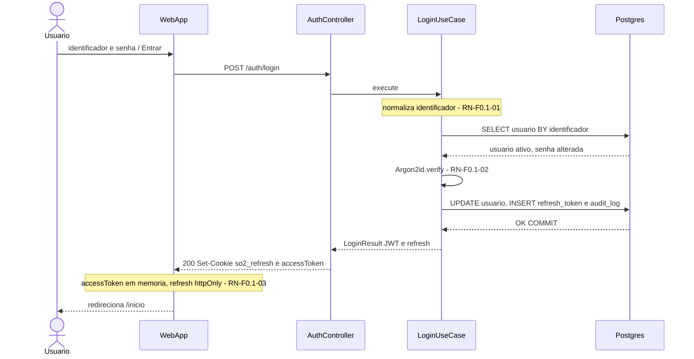

# F0.1-a — Login happy path

| Campo | Valor |
|---|---|
| HU | US-F0-001 |
| Escopo | happy path |
| Atores | Usuário, WebApp, AuthController, LoginUseCase, Postgres |
| Pré-condições | conta ativa; `senha_alterada = true`; &lt; 5 tentativas no último minuto |
| Origem | `docs/tcc-docs.md` §8.1 · CA-01 · RN-F0.1-01..03 |

## Passos

1. Usuário informa identificador (e-mail `@ufpr.br`, e-mail pessoal ou GRR) e senha; clica **Entrar**.
2. WebApp exibe loading no botão e envia `POST /auth/login` com JSON `{ identificador, senha }`.
3. AuthController chama `LoginUseCase.execute(...)`.
4. LoginUseCase normaliza o identificador (`IdentificadorLogin`) — RN-F0.1-01.
5. LoginUseCase → Postgres: `SELECT` usuário por identificador.
6. Postgres retorna usuário ativo, não bloqueado, `senha_alterada = true`.
7. LoginUseCase (self-call): `Argon2id.verify(senha, senha_hash)` em memória — RN-F0.1-02.
8. LoginUseCase → Postgres (mesma TX): `UPDATE` usuário (falhas = 0, último login); `INSERT` refresh_token opaco; `INSERT audit_log` (`iam.login_success`); emite JWT RS256 (TTL 15 min).
9. AuthController → WebApp: `200 OK` + `Set-Cookie` refresh (`httpOnly; Secure; SameSite=Lax`) + body `{ accessToken, mustChangePassword: false, expiresIn }`.
10. WebApp guarda `accessToken` só em memória e o refresh no cookie — RN-F0.1-03; redireciona para `/inicio`.

> O fluxo normal de **rotação** de refresh (token válido → novo par) fica implícito no passo 8 (emissão da sessão); o cenário de **reuso** é `F0.1-f`.

## Mermaid

## Export

Arquivo PlantUML: [`F0.1-a-login-happy-path.puml`](./F0.1-a-login-happy-path.puml)
