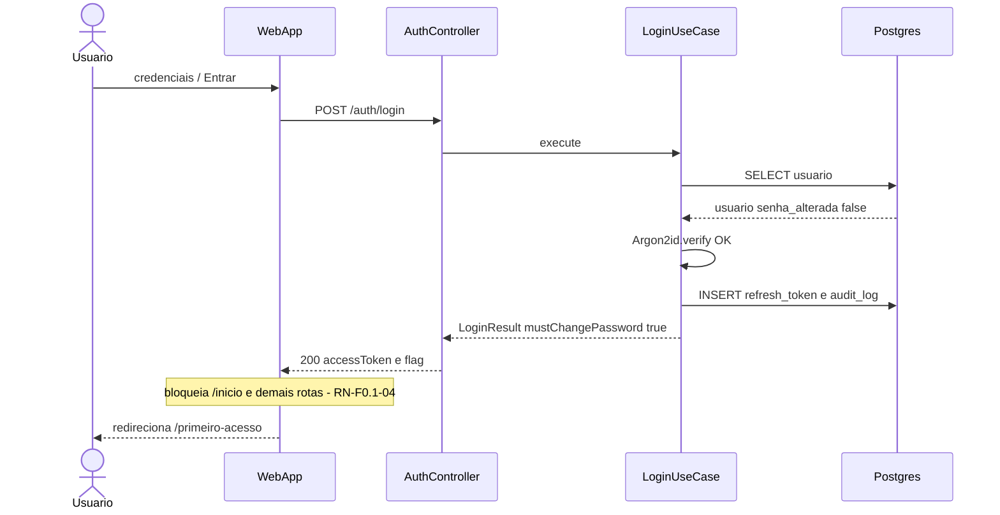

# F0.1-b — Login → primeiro acesso (`mustChangePassword`)

| Campo | Valor |
|---|---|
| HU | US-F0-001 |
| Escopo | happy path — `senha_alterada = false` |
| Atores | Usuário, WebApp, AuthController, LoginUseCase, Postgres |
| Pré-condições | conta ativa; `senha_alterada = false` |
| Origem | `docs/tcc-docs.md` §8.1 · CA-02 · RN-F0.1-04 |

## Passos

1. Usuário informa credenciais corretas e clica **Entrar**.
2. WebApp → AuthController: `POST /auth/login`.
3. AuthController → LoginUseCase → Postgres: mesma autenticação do happy path (SELECT + Argon2id).
4. LoginUseCase detecta `precisaPrimeiroAcesso() = true` (`senha_alterada = false`).
5. Emite tokens normalmente (JWT válido) + `mustChangePassword: true`.
6. AuthController → WebApp: `200` + cookie refresh + body com flag.
7. WebApp guarda tokens, **bloqueia** rotas protegidas (`/inicio` etc.) e redireciona para `/primeiro-acesso` — RN-F0.1-04.

> Conclusão do primeiro acesso (senha forte + LGPD) está em US-F1-002 / `F1.2-D01`.

## Mermaid

## Export

[`F0.1-b-primeiro-acesso.puml`](./F0.1-b-primeiro-acesso.puml)
