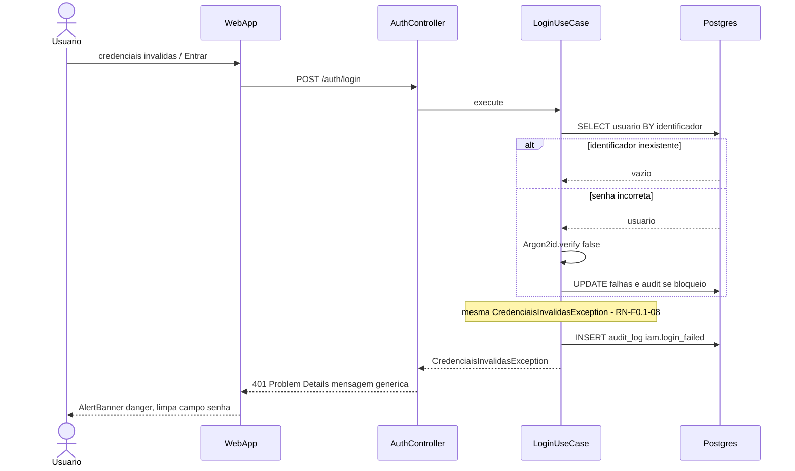

# F0.1-c — Login 401 — credenciais inválidas (anti-enumeração)

| Campo | Valor |
|---|---|
| HU | US-F0-001 |
| Escopo | erro 401 |
| Atores | Usuário, WebApp, AuthController, LoginUseCase, Postgres |
| Pré-condições | identificador inexistente **ou** senha incorreta; &lt; 10 falhas consecutivas; &lt; 5 tentativas/min |
| Origem | `docs/tcc-docs.md` §8.1 · CA-03 · RN-F0.1-08 |

## Passos

1. Usuário envia identificador/senha inválidos.
2. WebApp → AuthController: `POST /auth/login`.
3. LoginUseCase consulta Postgres (ou não encontra usuário / senha não bate).
4. Em ambos os casos: mesma exceção → `audit_log iam.login_failed` — RN-F0.1-08.
5. AuthController → WebApp: `401` RFC 7807 (`detail` genérico).
6. WebApp: mantém identificador, limpa senha, exibe AlertBanner danger.

## Mermaid

## Export

[`F0.1-c-credenciais-invalidas.puml`](./F0.1-c-credenciais-invalidas.puml)
