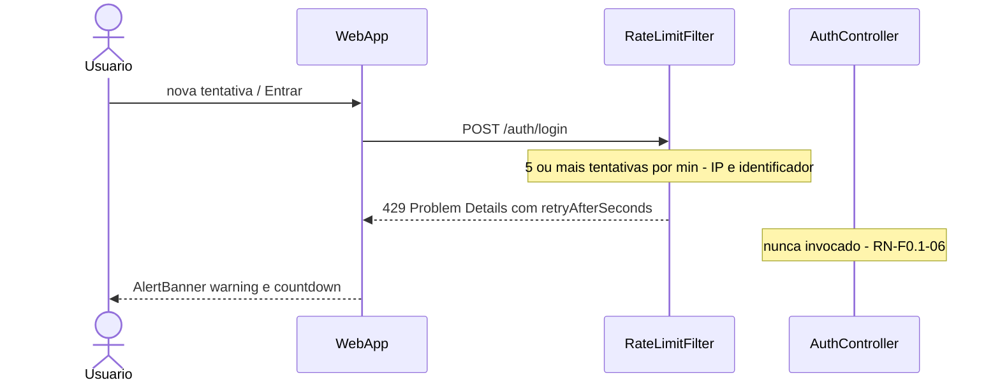

# F0.1-d — Login 429 — rate limit atingido

| Campo | Valor |
|---|---|
| HU | US-F0-001 |
| Escopo | erro 429 |
| Atores | Usuário, WebApp, RateLimitFilter, AuthController |
| Pré-condições | mesmo IP + identificador ≥ 5 tentativas em &lt; 1 minuto |
| Origem | `docs/tcc-docs.md` §8.1 · CA-04 · RN-F0.1-06 / RN-F0.1-09 |

## Passos

1. Usuário tenta login novamente após esgotar a janela.
2. WebApp → RateLimitFilter (antes do controller).
3. RateLimitFilter rejeita; **AuthController / LoginUseCase não são invocados** — RN-F0.1-06.
4. Resposta `429` RFC 7807 com `retryAfterSeconds` — RN-F0.1-09.
5. WebApp exibe AlertBanner warning + countdown; desabilita **Entrar**.

## Mermaid

## Export

[`F0.1-d-rate-limit.puml`](./F0.1-d-rate-limit.puml)
