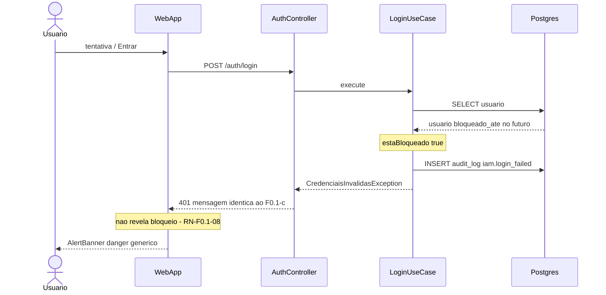

# F0.1-e — Login 401 — conta bloqueada

| Campo | Valor |
|---|---|
| HU | US-F0-001 |
| Escopo | erro 401 — bloqueio temporário |
| Atores | Usuário, WebApp, AuthController, LoginUseCase, Postgres |
| Pré-condições | identificador com 10 falhas consecutivas; rate limit (5/min) não bloqueou antes |
| Origem | `docs/tcc-docs.md` §8.1 · CA-05 · RN-F0.1-08 |

## Passos

1. Usuário tenta login com conta cujo `bloqueado_ate` ainda é futuro.
2. LoginUseCase carrega usuário e verifica bloqueio.
3. Recusa com a **mesma** resposta de credenciais inválidas — RN-F0.1-08.
4. Evento interno `iam.account_blocked` já foi (ou é) registrado; cliente **não** vê menção a bloqueio.
5. WebApp exibe a mesma mensagem genérica do `F0.1-c`.

## Mermaid

## Export

[`F0.1-e-conta-bloqueada.puml`](./F0.1-e-conta-bloqueada.puml)
