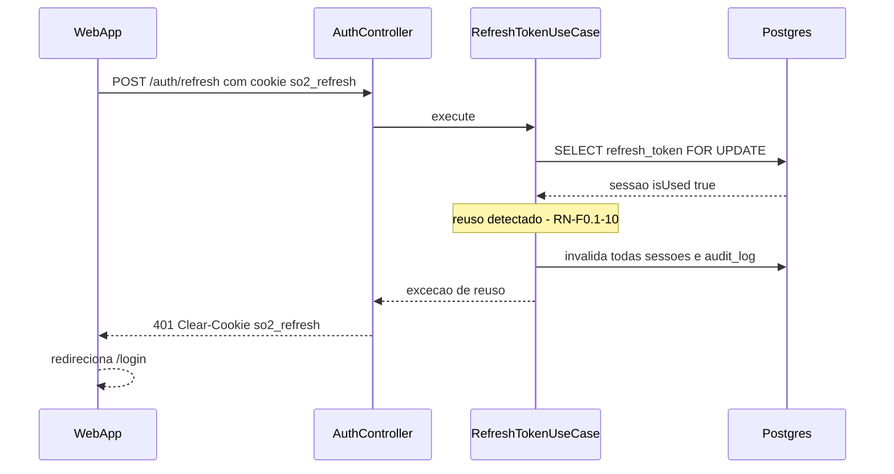

# F0.1-f — Refresh token — reuso detectado (revogação de sessões)

| Campo | Valor |
|---|---|
| HU | US-F0-001 (subfluxo) |
| Escopo | erro 401 — defesa contra roubo de cookie |
| Atores | WebApp, AuthController, RefreshTokenUseCase, Postgres |
| Pré-condições | cliente apresenta refresh já rotacionado (`isUsed = true`) |
| Origem | `docs/tcc-docs.md` §8.1 · RNF-SEC-03 · RN-F0.1-10 |

## Passos

1. WebApp envia `POST /auth/refresh` com cookie/refresh já usado.
2. RefreshTokenUseCase → Postgres: `SELECT … FOR UPDATE` da sessão — RN-F0.1-10.
3. Detecta `isUsed = true` → revoga **todas** as sessões do usuário.
4. Registra `iam.suspicious_token_reuse`.
5. AuthController → WebApp: `401`; limpa cookie refresh.
6. WebApp redireciona para `/login` (ou `/erro/401` via interceptor).

> Rotação normal (token válido → novo par) não tem diagrama separado; está implícita no happy path de emissão (`F0.1-a` passo 8).

## Mermaid

## Export

[`F0.1-f-refresh-reuso.puml`](./F0.1-f-refresh-reuso.puml)
