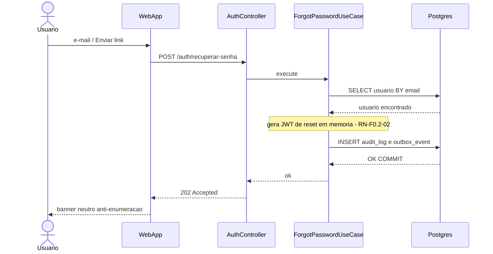

# F0.2-a — Solicitar reset (e-mail cadastrado) — happy path

| Campo | Valor |
|---|---|
| HU | US-F0-002 |
| Escopo | happy path — e-mail existe na base |
| Atores | Usuário, WebApp, AuthController, ForgotPasswordUseCase, Postgres |
| Pré-condições | e-mail com formato válido; conta ativa; &lt; 3 tentativas na última hora |
| Origem | `docs/tcc-docs.md` §8.1 · CA-01 · RN-F0.2-01..03 |

## Passos

1. Usuário informa e-mail e clica **Enviar link**.
2. WebApp → AuthController: `POST /auth/recuperar-senha`.
3. AuthController → ForgotPasswordUseCase.
4. UseCase → Postgres: `SELECT` usuário por e-mail; encontra conta.
5. UseCase gera JWT de reset em memória (não persiste ainda) — RN-F0.2-02.
6. UseCase → Postgres (mesma TX): `INSERT audit_log` (`iam.password_reset_requested`) + `INSERT outbox_event` (template `PASSWORD_RESET`) — RN-F0.2-03.
7. AuthController → WebApp: `202 Accepted`.
8. WebApp exibe banner neutro: "Se este e-mail estiver cadastrado…" (idêntico ao F0.2-b) — RN-F0.2-01.

> Envio do e-mail é assíncrono via Outbox (não sincroniza neste diagrama).

## Mermaid

## Export

[`F0.2-a-reset-email-cadastrado.puml`](./F0.2-a-reset-email-cadastrado.puml)
