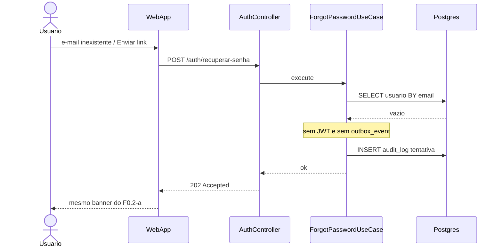

# F0.2-b — Solicitar reset (e-mail não cadastrado) — anti-enumeração

| Campo | Valor |
|---|---|
| HU | US-F0-002 |
| Escopo | e-mail informado não existe na base |
| Atores | Usuário, WebApp, AuthController, ForgotPasswordUseCase, Postgres |
| Pré-condições | e-mail com formato válido; não cadastrado |
| Origem | `docs/tcc-docs.md` §8.1 · CA-02 · RN-F0.2-01 / RN-F0.2-07 |

## Passos

1. Usuário informa e-mail inexistente e clica **Enviar link**.
2. WebApp → AuthController → ForgotPasswordUseCase.
3. UseCase → Postgres: `SELECT` não encontra usuário.
4. **Não** gera JWT; **não** insere `outbox_event` — zero e-mails.
5. Registra `audit_log` da tentativa (e-mail ofuscado) — RN-F0.2-07.
6. Resposta `202` + banner **idênticos** ao F0.2-a — RN-F0.2-01.

## Mermaid

## Export

[`F0.2-b-reset-email-inexistente.puml`](./F0.2-b-reset-email-inexistente.puml)
