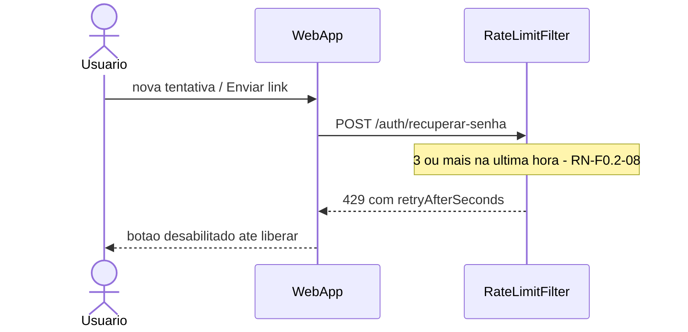

# F0.2-c — Solicitar reset — 429 rate limit

| Campo | Valor |
|---|---|
| HU | US-F0-002 |
| Escopo | erro 429 — spam de e-mails de recuperação |
| Atores | Usuário, WebApp, RateLimitFilter |
| Pré-condições | mesmo e-mail + IP ≥ 3 solicitações na última hora |
| Origem | `docs/tcc-docs.md` §8.1 · RN-F0.2-08 |

## Passos

1. Usuário tenta enviar de novo após esgotar a janela.
2. WebApp → RateLimitFilter: `POST /auth/recuperar-senha`.
3. Filter rejeita; **ForgotPasswordUseCase nunca é invocado** — RN-F0.2-08.
4. Resposta `429` RFC 7807 com `retryAfterSeconds`.
5. WebApp desabilita o botão até liberar.

> Janela de 1 hora (mais restritiva que o login) — mitiga spam de e-mail, não força bruta de senha.

## Mermaid

## Export

[`F0.2-c-reset-rate-limit.puml`](./F0.2-c-reset-rate-limit.puml)
