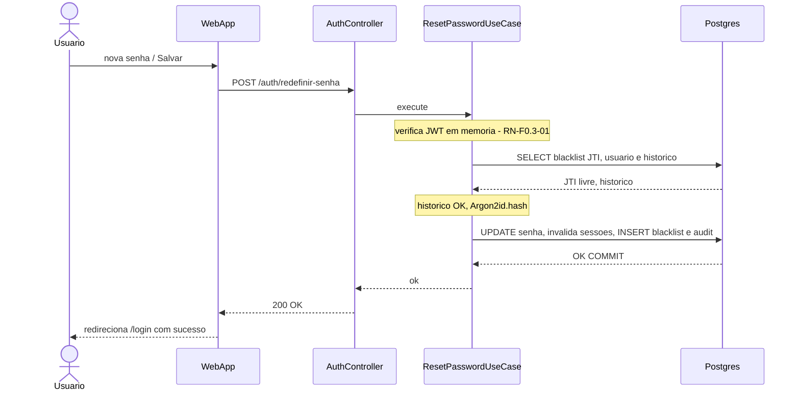

# F0.3-a — Redefinição bem-sucedida (happy path)

| Campo | Valor |
|---|---|
| HU | US-F0-003 |
| Escopo | happy path — token válido, senha forte, sem reuso |
| Atores | Usuário, WebApp, AuthController, ResetPasswordUseCase, Postgres |
| Pré-condições | JWT não expirado; JTI não consumido; senha ≥ 12 chars com complexidade; diferente das 3 últimas |
| Origem | `docs/tcc-docs.md` §8.1 · CA-05 · RN-F0.3-01..03 / 06 / 08 |

## Passos

1. Usuário em `/nova-senha?token=…` envia nova senha + confirmação.
2. WebApp → AuthController: `POST /auth/redefinir-senha`.
3. ResetPasswordUseCase verifica JWT em memória (assinatura, audience, exp) — RN-F0.3-01.
4. UseCase → Postgres: `SELECT` blacklist JTI + usuário + histórico de senhas.
5. Self-call: confirma que a nova senha **não** bate com as 3 últimas (Argon2id) — RN-F0.3-06.
6. Self-call / CPU: `Argon2id.hash(novaSenha)` antes da TX — RN-F0.3-02.
7. TX atômica: `UPDATE` senha + `senha_alterada=true`; invalida refresh tokens — RN-F0.3-08; `INSERT` JTI na blacklist — RN-F0.3-03; `INSERT audit_log` (`iam.password_reset_completed`). Ou salva tudo, ou não salva nada.
8. AuthController → WebApp: `200 OK`.
9. WebApp redireciona para `/login` com banner de sucesso.

> No máximo 1 self-call visível no desenho: preferir o `Argon2id.hash` (passo 6); o check de histórico pode ir como nota no mesmo UseCase.

## Mermaid

## Export

[`F0.3-a-redefinir-senha-ok.puml`](./F0.3-a-redefinir-senha-ok.puml)
