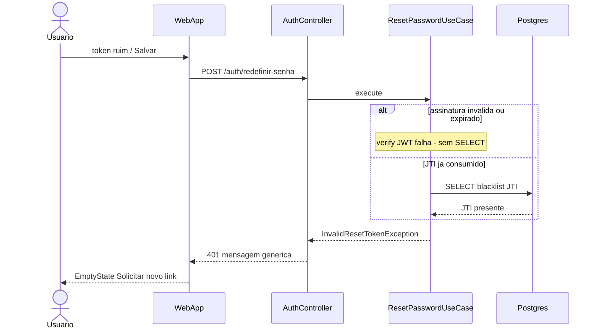

# F0.3-b — 401 token inválido, expirado ou já consumido

| Campo | Valor |
|---|---|
| HU | US-F0-003 |
| Escopo | erro 401 — CA-06 e CA-07 |
| Atores | Usuário, WebApp, AuthController, ResetPasswordUseCase, Postgres |
| Pré-condições | assinatura inválida, exp expirado, **ou** JTI já na blacklist |
| Origem | `docs/tcc-docs.md` §8.1 · CA-06/07 · RN-F0.3-01/02 |

## Passos

1. Usuário tenta salvar (ou a tela valida o token) com JWT ruim / consumido.
2. ResetPasswordUseCase:
   - **CA-06:** verify JWT falha em memória → **não** chega no DB;
   - **CA-07:** JWT ok, mas `SELECT` acha JTI na blacklist.
3. Mesma exceção / mesmo `401` nos dois ramos (anti-enumeração).
4. WebApp troca o formulário por EmptyState + botão **Solicitar novo link** → `/recuperar-senha`.

## Mermaid

## Export

[`F0.3-b-token-invalido.puml`](./F0.3-b-token-invalido.puml)
