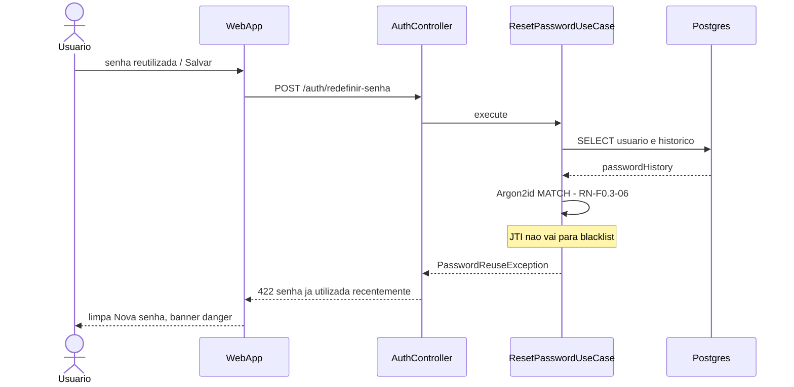

# F0.3-c — 422 senha reutilizada

| Campo | Valor |
|---|---|
| HU | US-F0-003 |
| Escopo | erro 422 — nova senha igual a uma das 3 últimas |
| Atores | Usuário, WebApp, AuthController, ResetPasswordUseCase, Postgres |
| Pré-condições | token JWT válido; JTI não consumido |
| Origem | `docs/tcc-docs.md` §8.1 · CA-04 · RN-F0.3-05/06 |

## Passos

1. Usuário envia senha que já usou recentemente.
2. UseCase valida JWT e carrega histórico.
3. Self-call: Argon2id encontra MATCH em uma das 3 últimas — RN-F0.3-06.
4. Lança `PasswordReuseException` → `422` RFC 7807.
5. **JTI não** entra na blacklist — token continua válido para nova tentativa.
6. WebApp limpa o campo “Nova senha” e mostra banner danger.

## Mermaid

## Export

[`F0.3-c-senha-reutilizada.puml`](./F0.3-c-senha-reutilizada.puml)
