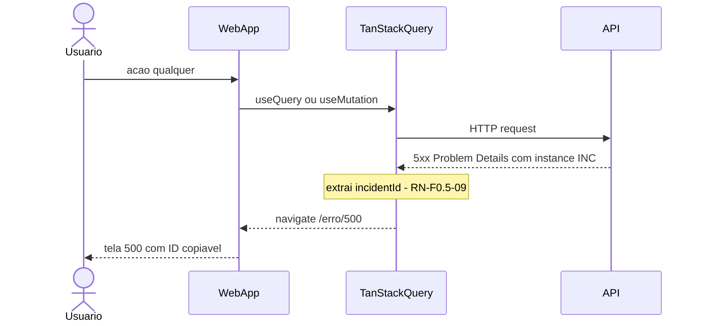

# F0.5-a — `/erro/500` com incidentId

| Campo | Valor |
|---|---|
| HU | US-F0-005 |
| Escopo | interceptor global captura 5xx e extrai incidentId do RFC 7807 |
| Atores | Usuário, WebApp, TanStack Query, API |
| Pré-condições | usuário autenticado; qualquer `useQuery` / `useMutation` ativa |
| Origem | `docs/tcc-docs.md` §8.1 · CA-04/05 · RN-F0.5-05 / 09 |

## Passos

1. Usuário dispara ação que gera chamada HTTP.
2. WebApp / TanStack Query chama a API.
3. API responde `5xx` com Problem Details; campo `instance` = `INC-YYYY-XXXX` — RN-F0.5-05.
4. Interceptor global extrai `instance` e navega para `/erro/500` com `incidentId` — RN-F0.5-09.
5. Tela exibe ID copiável; **sem** stack trace — CA-06.

> Diagrama transversal: vale para qualquer módulo quando o backend devolve 5xx.

## Mermaid

## Export

[`F0.5-a-erro-5xx-incidentid.puml`](./F0.5-a-erro-5xx-incidentid.puml)
