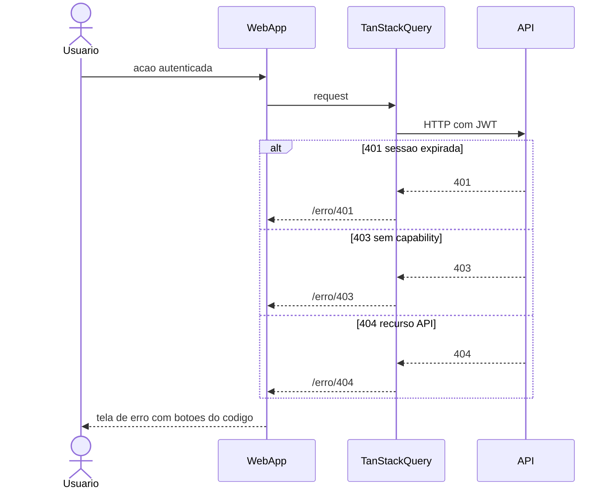

# F0.5-b API 4xx → `/erro/:codigo`

| Campo | Valor |
|---|---|
| HU | US-F0-005 |
| Escopo | interceptor captura 401, 403 e 404 vindos da API |
| Atores | Usuário, WebApp, TanStack Query, API |
| Pré-condições | usuário autenticado com JWT; token pode estar expirado ou recurso inacessível |
| Origem | `docs/tcc-docs.md` §8.1 · CA-01..03 · RN-F0.5-06/07 |

## Passos

1. Chamada autenticada à API.
2. API responde `401` / `403` / `404`.
3. Interceptor redireciona para `/erro/401`, `/erro/403` ou `/erro/404`.
4. Botões da tela dependem só do código HTTP (sem novo round-trip).

Notas rápidas:
- **401** sessão expirada (JWT expirou no meio da sessão). Tentativa de refresh fica implícita (`F0.1-f`); diferente do guard sem JWT (não chega a chamar a API).
- **403** FGAC / capability ausente.
- **404** recurso de API inexistente (rota fantasma no React Router é outro caminho, sem este diagrama).

## Mermaid

## Export

[`F0.5-b-erro-4xx.puml`](./F0.5-b-erro-4xx.puml)
