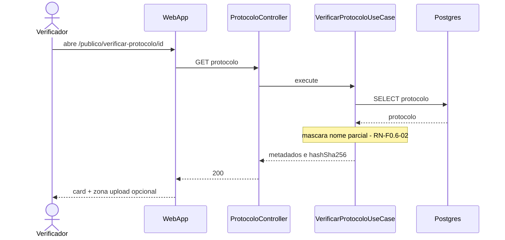

# F0.6-a — Verificar protocolo (protocolo encontrado)

| Campo | Valor |
|---|---|
| HU | US-F0-006 |
| Escopo | happy path — GET retorna metadados sanitizados |
| Atores | Verificador, WebApp, ProtocoloController, VerificarProtocoloUseCase, Postgres |
| Pré-condições | endpoint público, sem JWT; ID válido e existente; &lt; 10 req/min do IP |
| Origem | `docs/tcc-docs.md` §8.1 · CA-01 · RN-F0.6-01..03 / 09 |

## Passos

1. Verificador abre `/publico/verificar-protocolo/:id`.
2. WebApp → ProtocoloController (público; RateLimit só por IP) — RN-F0.6-01.
3. UseCase → Postgres: busca protocolo.
4. UseCase mascara `solicitanteNomeParcial` (ex.: `A S**`); nunca GRR — RN-F0.6-02 / LGPD.
5. Resposta `200` com metadados + `hashSha256` completo (truncamento visual no React) — RN-F0.6-03.
6. WebApp exibe card + zona de upload opcional.

## Mermaid

## Export

[`F0.6-a-protocolo-encontrado.puml`](./F0.6-a-protocolo-encontrado.puml)
