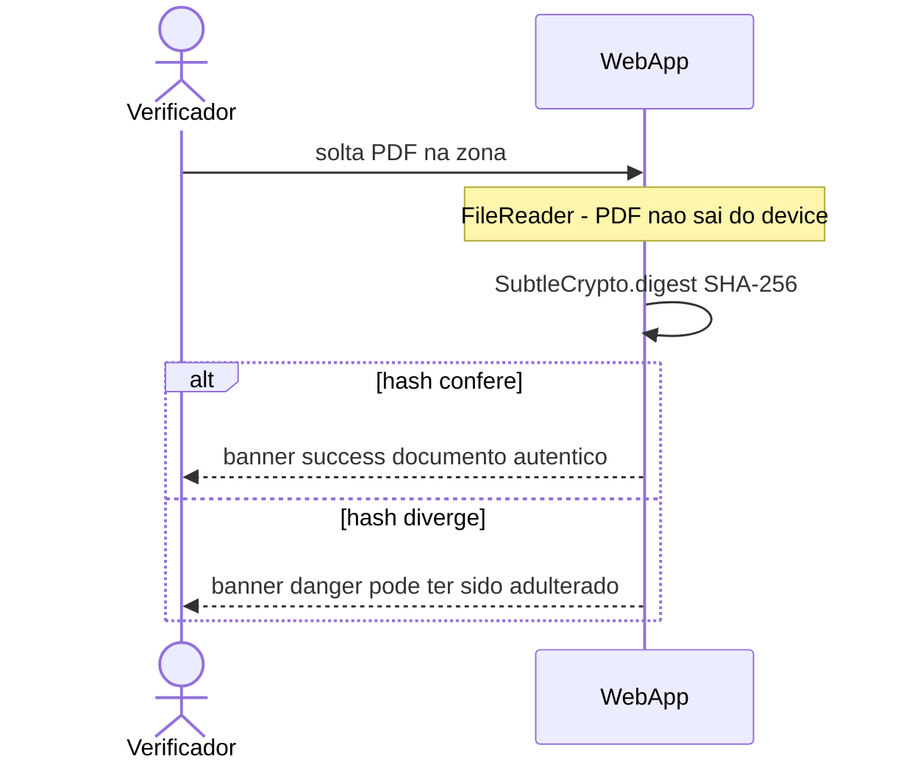

# F0.6-b — Verificação de integridade por upload (SHA-256 local)

| Campo | Valor |
|---|---|
| HU | US-F0-006 |
| Escopo | client-side — hash no browser, sem envio ao servidor |
| Atores | Verificador, WebApp |
| Pré-condições | F0.6-a já rodou; `hashSha256` esperado em memória no React |
| Origem | `docs/tcc-docs.md` §8.1 · CA-02/03 · RN-F0.6-04..06 |

## Passos

1. Verificador solta/seleciona o PDF na zona de upload.
2. WebApp lê o arquivo via `FileReader` — PDF **não** sai do dispositivo — RN-F0.6-04/06.
3. Web Crypto: `SubtleCrypto.digest` → SHA-256 local.
4. Compara com o hash esperado do F0.6-a.
5. **Confere** → banner success; **não confere** → banner danger (não confiar / contatar secretaria).

> Zero mensagens HTTP neste diagrama.

## Mermaid

## Export

[`F0.6-b-hash-local.puml`](./F0.6-b-hash-local.puml)
