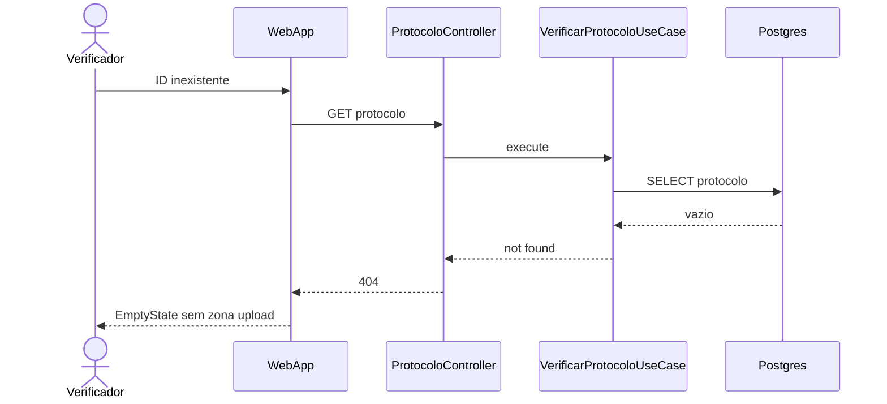

# F0.6-c — Protocolo não encontrado (404)

| Campo | Valor |
|---|---|
| HU | US-F0-006 |
| Escopo | erro 404 — ID sem protocolo registrado |
| Atores | Verificador, WebApp, ProtocoloController, VerificarProtocoloUseCase, Postgres |
| Pré-condições | endpoint público; &lt; 10 req/min; ID inexistente |
| Origem | `docs/tcc-docs.md` §8.1 · CA-04 |

## Passos

1. Verificador abre ID inexistente.
2. UseCase → Postgres: vazio.
3. `404` Problem Details: "Nenhum protocolo registrado…".
4. WebApp: EmptyState; **sem** zona de upload (não há hash para comparar).

## Mermaid

## Export

[`F0.6-c-protocolo-404.puml`](./F0.6-c-protocolo-404.puml)
