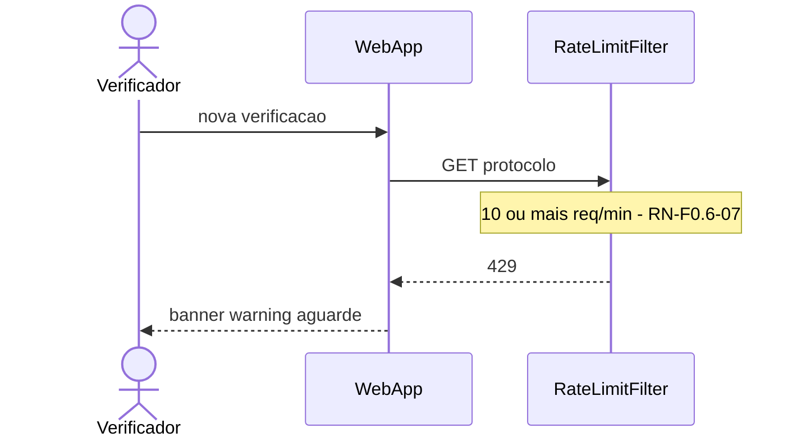

# F0.6-d — Rate limit atingido (429)

| Campo | Valor |
|---|---|
| HU | US-F0-006 |
| Escopo | erro 429 — proteção contra enumeração de IDs |
| Atores | Verificador, WebApp, RateLimitFilter |
| Pré-condições | mesmo IP ≥ 10 req ao endpoint em &lt; 1 minuto |
| Origem | `docs/tcc-docs.md` §8.1 · CA-06 · RN-F0.6-07 |

## Passos

1. Verificador excede o limite.
2. RateLimitFilter rejeita **antes** do ProtocoloController — RN-F0.6-07.
3. `429` → banner warning na tela.

## Mermaid

## Export

[`F0.6-d-protocolo-429.puml`](./F0.6-d-protocolo-429.puml)
