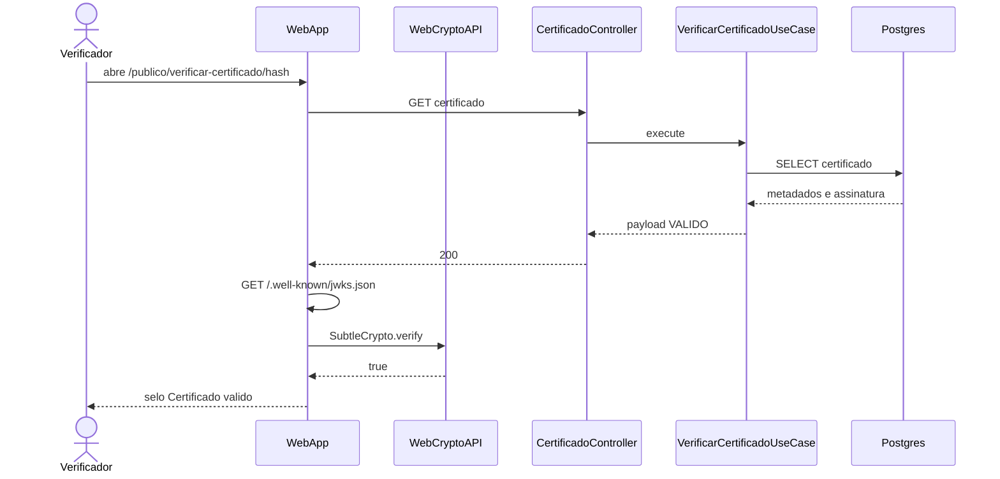

# F0.7-a — Certificado válido (GET + JWKS + ED25519.verify)

| Campo | Valor |
|---|---|
| HU | US-F0-007 |
| Escopo | happy path — hash encontrado, assinatura válida, status=VALIDO |
| Atores | Verificador, WebApp, Web Crypto API, CertificadoController, VerificarCertificadoUseCase, Postgres |
| Pré-condições | endpoint público; hash existente; &lt; 10 req/min do IP |
| Origem | `docs/tcc-docs.md` §8.1 · CA-01 · RN-F0.7-05/06/08/10/11 |

## Passos

1. Verificador abre `/publico/verificar-certificado/:hash`.
2. WebApp → CertificadoController (público; rate limit por IP) — RN-F0.7-10.
3. UseCase → Postgres; retorna metadados + assinatura ED25519 (nome completo ou mascarado; sem GRR/e-mail) — RN-F0.7-08/11.
4. WebApp busca chave pública em `/.well-known/jwks.json` — RN-F0.7-06.
5. Web Crypto: `SubtleCrypto.verify` no browser — RN-F0.7-05.
6. Verify OK → selo/badge **Certificado válido** + dados do beneficiário.

## Mermaid

## Export

[`F0.7-a-certificado-valido.puml`](./F0.7-a-certificado-valido.puml)
