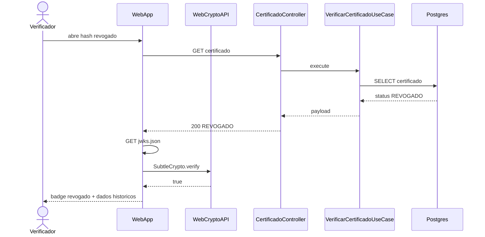

# F0.7-b — Certificado revogado (`status=REVOGADO`)

| Campo | Valor |
|---|---|
| HU | US-F0-007 |
| Escopo | hash encontrado, assinatura original válida, status=REVOGADO |
| Atores | Verificador, WebApp, Web Crypto API, CertificadoController, VerificarCertificadoUseCase, Postgres |
| Pré-condições | certificado emitido e depois revogado (ex.: atividade cancelada) |
| Origem | `docs/tcc-docs.md` §8.1 · CA-03 · RN-F0.7-07 |

## Passos

1. Mesmo GET do happy path; backend devolve `status=REVOGADO` — RN-F0.7-07.
2. WebApp ainda busca JWKS e verifica ED25519 (prova que foi emitido de verdade antes da revogação).
3. UI: badge **warning** “Certificado revogado” + dados históricos básicos (diferente do inválido).

> REVOGADO e upload de PDF (CA-04) estão fora da demonstração (4.11); o diagrama documenta o comportamento especificado.

## Mermaid

## Export

[`F0.7-b-certificado-revogado.puml`](./F0.7-b-certificado-revogado.puml)
