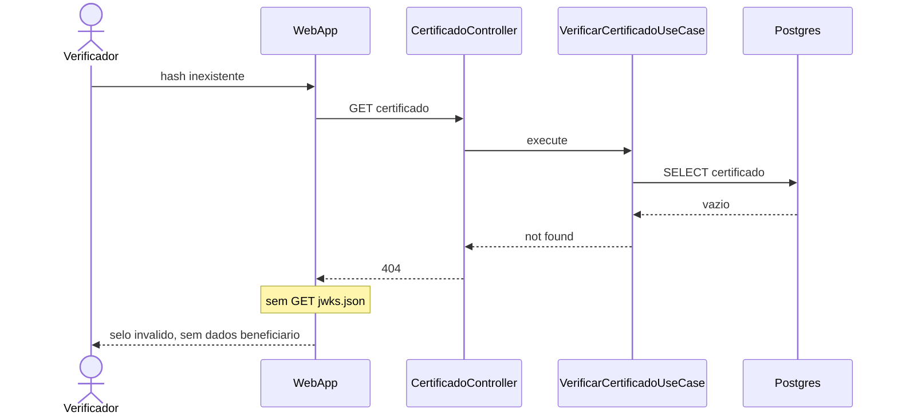

# F0.7-c — 404 hash não encontrado

| Campo | Valor |
|---|---|
| HU | US-F0-007 |
| Escopo | erro 404 — hash sem certificado registrado |
| Atores | Verificador, WebApp, CertificadoController, VerificarCertificadoUseCase, Postgres |
| Pré-condições | hash inexistente (nunca emitido ou adulterado) |
| Origem | `docs/tcc-docs.md` §8.1 · CA-02 · RN-F0.7-09 |

## Passos

1. GET com hash inexistente.
2. Postgres vazio → `404`.
3. WebApp: selo inválido + mensagem genérica; **sem** dados do beneficiário — RN-F0.7-09.
4. **Sem** chamada a JWKS (não há assinatura para verificar).

## Mermaid

## Export

[`F0.7-c-certificado-404.puml`](./F0.7-c-certificado-404.puml)
