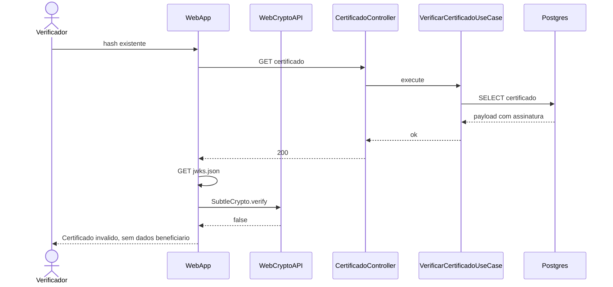

# F0.7-d — Assinatura ED25519 inválida (tampering)

| Campo | Valor |
|---|---|
| HU | US-F0-007 |
| Escopo | hash existe (200), mas `SubtleCrypto.verify` = false |
| Atores | Verificador, WebApp, Web Crypto API, CertificadoController, VerificarCertificadoUseCase, Postgres |
| Pré-condições | hash na base; assinatura forjada ou response adulterado (MITM) |
| Origem | `docs/tcc-docs.md` §8.1 · CA-02 · RN-F0.7-05/06 |

## Passos

1. Backend devolve `200` com metadados + assinatura (pode estar comprometida).
2. WebApp busca JWKS (fonte de verdade independente).
3. `SubtleCrypto.verify` → `false`.
4. UI: **Certificado inválido**; **não** exibe dados do beneficiário.

> Duas camadas: F0.7-c = não está no DB; F0.7-d = está no DB, mas a criptografia falha.

## Mermaid

## Export

[`F0.7-d-assinatura-invalida.puml`](./F0.7-d-assinatura-invalida.puml)
