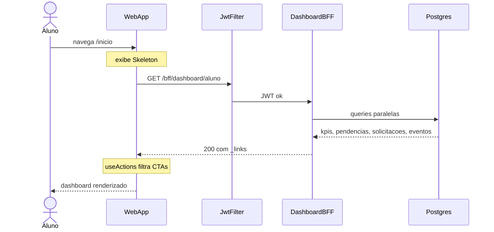

# F1.1-D01 — Carregamento inicial do dashboard (cache MISS)

| Campo | Valor |
|---|---|
| HU | US-F1-001 |
| Escopo | happy path — primeiro carregamento; BFF lê Postgres (sem Redis) |
| Atores | Aluno, WebApp, JwtFilter, DashboardBFF, Postgres |
| Pré-condições | autenticado; `mustChangePassword = false`; JWT com `dashboard.view_own` |
| Origem | `docs/tcc-docs.md` §8.2 · CA-01 · RN-F1.1 |

## Passos

1. Aluno navega para `/inicio` (skeleton nos blocos).
2. WebApp → JwtFilter → DashboardBFF: `GET /bff/dashboard/aluno`.
3. BFF dispara queries em paralelo no Postgres (KPIs, pendências, solicitações, eventos…).
4. Resposta `200` com `_links`; WebApp usa `useActions` (ex.: “Nova solicitação” só se `_links.novaSolicitacao` existir).
5. Skeleton some; painel renderiza.

## Mermaid

## Export

[`F1.1-D01-dashboard-cache-miss.puml`](./F1.1-D01-dashboard-cache-miss.puml)
