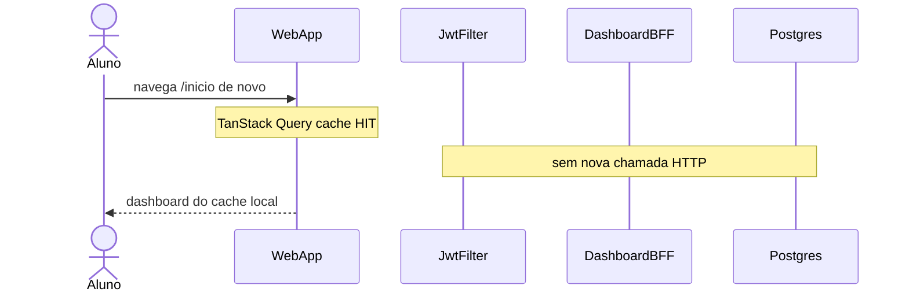

# F1.1-D02 — Carregamento do dashboard (cache HIT)

| Campo | Valor |
|---|---|
| HU | US-F1-001 |
| Escopo | retorno rápido via cache **TanStack Query** no cliente (sem Redis) |
| Atores | Aluno, WebApp, JwtFilter, DashboardBFF, Postgres |
| Pré-condições | dashboard já carregado recentemente; cache local ainda fresco |
| Origem | `docs/tcc-docs.md` §8.2 · RN-F1.1-10 |

## Passos

1. Aluno volta a `/inicio` (ou remonta a tela) com cache TanStack ainda válido.
2. WebApp serve os dados do **cache local** — sem nova ida ao BFF/Postgres neste HIT.
3. FCP rápido (&lt; 1,5 s na meta do doc).

> Não há Redis. Pull-to-refresh (D04) invalida só o cache do cliente. JwtFilter/BFF/Postgres aparecem no diagrama como “não chamados” neste cenário.

## Mermaid

## Export

[`F1.1-D02-dashboard-cache-hit.puml`](./F1.1-D02-dashboard-cache-hit.puml)
