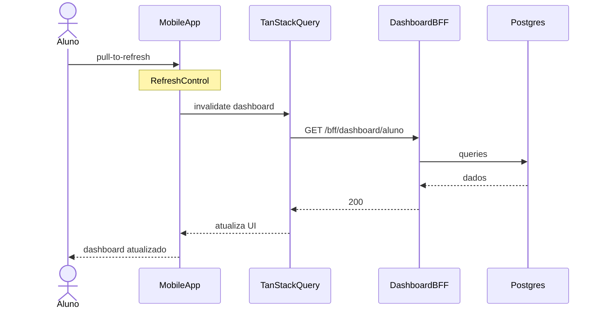

# F1.1-D04 — Pull-to-refresh no mobile

| Campo | Valor |
|---|---|
| HU | US-F1-001 |
| Escopo | gesto invalida cache TanStack e rebusca o BFF |
| Atores | Aluno, MobileApp, TanStackQuery, DashboardBFF, Postgres |
| Pré-condições | app mobile; dashboard já carregado |
| Origem | `docs/tcc-docs.md` §8.2 · CA-07 · RN-F1.1-11 |

## Passos

1. Aluno puxa a tela (RefreshControl aparece).
2. MobileApp pede ao TanStack Query invalidar `/bff/dashboard/aluno`.
3. Nova chamada ao DashboardBFF → Postgres.
4. UI atualiza; indicador some.

## Mermaid

## Export

[`F1.1-D04-pull-to-refresh.puml`](./F1.1-D04-pull-to-refresh.puml)
