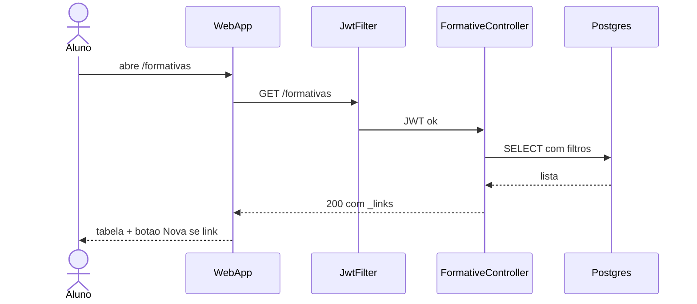

# F1.10-D01 — Listar formativas do aluno

| Campo | Valor |
|---|---|
| HU | US-F1-006 |
| Escopo | happy path — `/formativas` com filtros |
| Atores | Aluno, WebApp, JwtFilter, FormativeController, Postgres |
| Pré-condições | `formative.view_own` |
| Origem | `docs/tcc-docs.md` §8.2 · CA-01 |

## Passos

1. Aluno abre `/formativas`.
2. `GET /formativas` (+ filtros estado/tipo).
3. `200` + `_links.nova` só se `formative.submit`.
4. Entradas `PENDENTE_CONFIRMACAO` aparecem com CTA para confirmar (D03).

## Mermaid

## Export

[`F1.10-D01-listar-formativas.puml`](./F1.10-D01-listar-formativas.puml)
