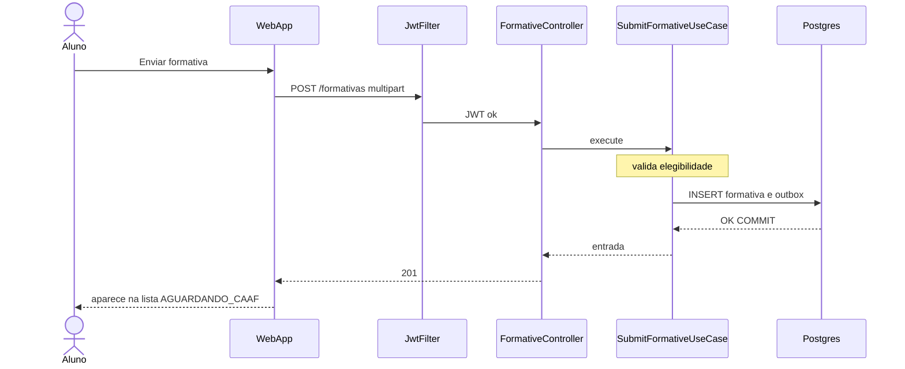

# F1.11-D02 — Submeter formativa manualmente

| Campo | Valor |
|---|---|
| HU | US-F1-006 |
| Escopo | `POST /formativas` multipart → `AGUARDANDO_CAAF` |
| Atores | Aluno, WebApp, JwtFilter, FormativeController, SubmitFormativeUseCase, Postgres |
| Pré-condições | tipo elegível; comprovante no multipart |
| Origem | `docs/tcc-docs.md` §8.2 · CA-02 · RN-F1.11-01..03 |

## Passos

1. Aluno envia tipo, horas e PDF.
2. UseCase valida elegibilidade do tipo para o curso.
3. Persiste entrada (`origem=COMPROVANTE`, estado `AGUARDANDO_CAAF`) + `outbox_event` na mesma TX.
4. CAAF é notificada via Outbox após COMMIT.

## Mermaid

## Export

[`F1.11-D02-submeter-formativa.puml`](./F1.11-D02-submeter-formativa.puml)
