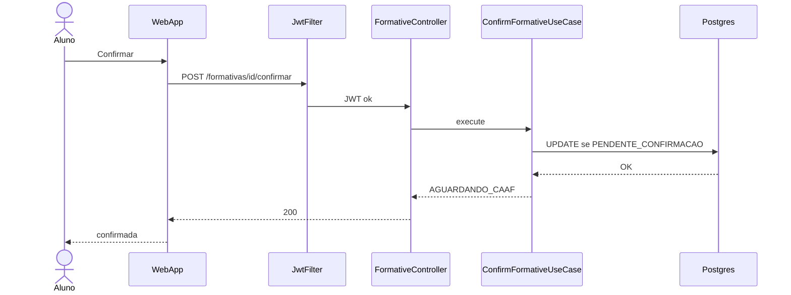

# F1.11-D03 — Confirmar formativa pré-validada

| Campo | Valor |
|---|---|
| HU | US-F1-006 |
| Escopo | 1 clique; sem upload — presença já validada no evento |
| Atores | Aluno, WebApp, JwtFilter, FormativeController, ConfirmFormativeUseCase, Postgres |
| Pré-condições | entrada `PENDENTE_CONFIRMACAO` criada ao encerrar evento |
| Origem | `docs/tcc-docs.md` §8.2 · CA-03 · RN-F1.11-04 |

## Passos

1. Aluno confirma formulário pré-preenchido.
2. `POST /formativas/{id}/confirmar` com guard `estado=PENDENTE_CONFIRMACAO` (senão 409).
3. Estado → `AGUARDANDO_CAAF`; sem comprovante.

## Mermaid

## Export

[`F1.11-D03-confirmar-formativa.puml`](./F1.11-D03-confirmar-formativa.puml)
