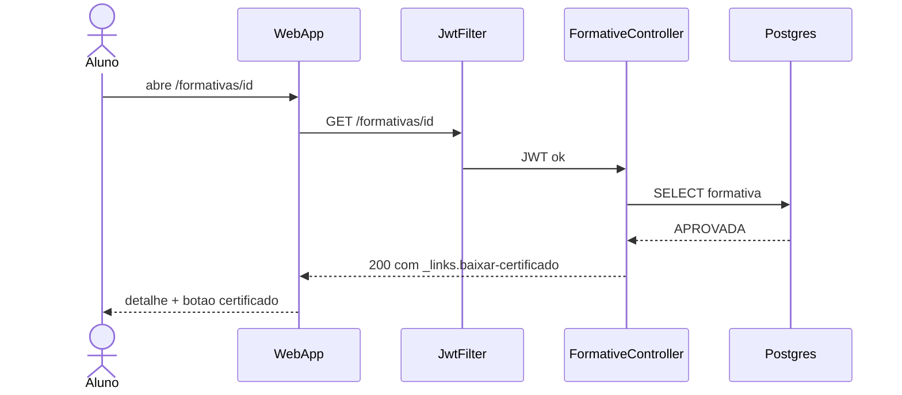

# F1.12-D04 — Detalhe da formativa aprovada

| Campo | Valor |
|---|---|
| HU | US-F1-006 |
| Escopo | `GET /formativas/{id}` + `_links.baixar-certificado` |
| Atores | Aluno, WebApp, JwtFilter, FormativeController, Postgres |
| Pré-condições | `formative.view_own`; estado `APROVADA` |
| Origem | `docs/tcc-docs.md` §8.2 · CA-04 · RN-F1.12-01/02 |

## Passos

1. Aluno abre `/formativas/:id`.
2. `GET` retorna detalhe; `_links.baixar-certificado` só se aprovada e certificado emitido.
3. Clique no link → fluxo de download em certificados (US-F1-010).

## Mermaid

## Export

[`F1.12-D04-detalhe-formativa.puml`](./F1.12-D04-detalhe-formativa.puml)
