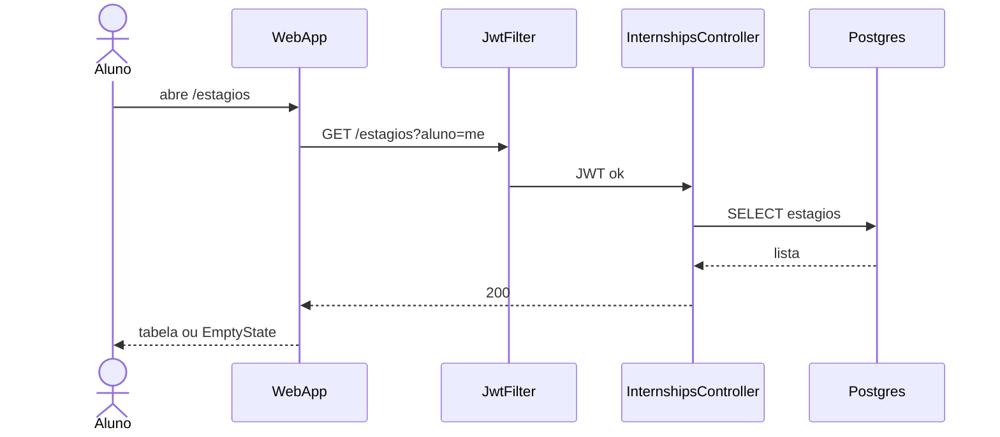

# F1.13-D01 — Listar estágios do aluno

| Campo | Valor |
|---|---|
| HU | US-F1-007 |
| Escopo | happy path — estágios registrados pela secretaria |
| Atores | Aluno, WebApp, JwtFilter, InternshipsController, Postgres |
| Pré-condições | `internship.view_own` |
| Origem | `docs/tcc-docs.md` §8.2 · CA-01 · RN-F1.13-01/02 |

## Passos

1. Aluno abre `/estagios`.
2. `GET /estagios?aluno=me` (+ filtro situação).
3. Sem `_links.novo` — aluno não cria estágio (só secretaria).

## Mermaid

## Export

[`F1.13-D01-listar-estagios.puml`](./F1.13-D01-listar-estagios.puml)
