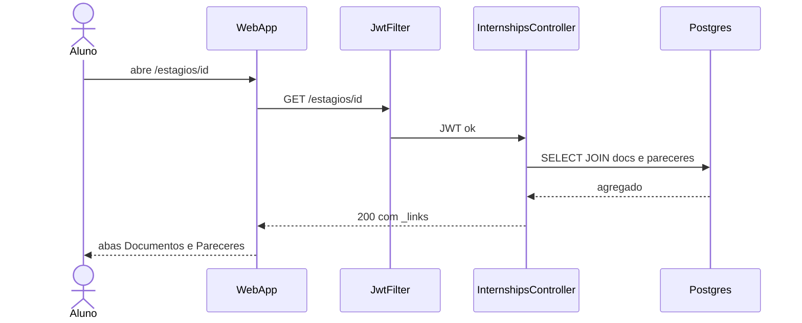

# F1.14-D02 — Detalhe do estágio

| Campo | Valor |
|---|---|
| HU | US-F1-007 |
| Escopo | uma resposta: documentos + pareceres + `_links` |
| Atores | Aluno, WebApp, JwtFilter, InternshipsController, Postgres |
| Pré-condições | estágio pertence ao aluno |
| Origem | `docs/tcc-docs.md` §8.2 · RN-F1.14-01/02/04 |

## Passos

1. `GET /estagios/{id}` — JOIN único; tabs só no cliente.
2. `_links.upload` por tipo de documento quando ainda pode enviar.
3. Pareceres em ordem decrescente de data.

## Mermaid

## Export

[`F1.14-D02-detalhe-estagio.puml`](./F1.14-D02-detalhe-estagio.puml)
