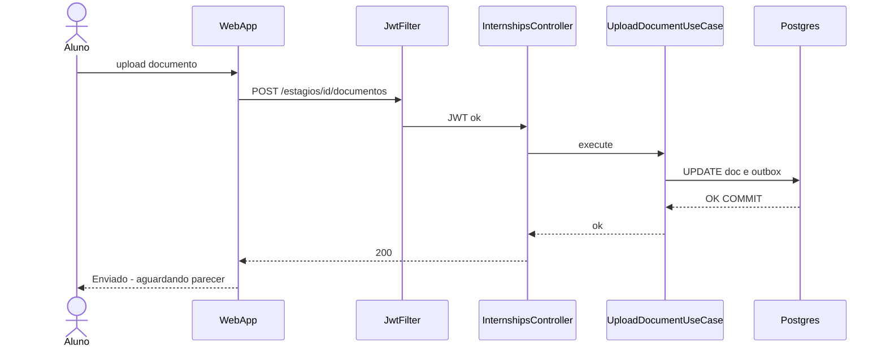

# F1.14-D03 — Enviar documento de estágio

| Campo | Valor |
|---|---|
| HU | US-F1-007 |
| Escopo | `POST /estagios/{id}/documentos` multipart + Outbox |
| Atores | Aluno, WebApp, JwtFilter, InternshipsController, UploadDocumentUseCase, Postgres |
| Pré-condições | `_links.upload` presente para o tipo |
| Origem | `docs/tcc-docs.md` §8.2 · CA-02 · RN-F1.14-02/03 |

## Passos

1. Aluno envia PDF do tipo permitido.
2. UseCase valida tipo (HATEOAS no backend); persiste + `outbox_event` na mesma TX.
3. Orientador/COE notificados após COMMIT (in-app + e-mail).

## Mermaid

## Export

[`F1.14-D03-enviar-documento-estagio.puml`](./F1.14-D03-enviar-documento-estagio.puml)
