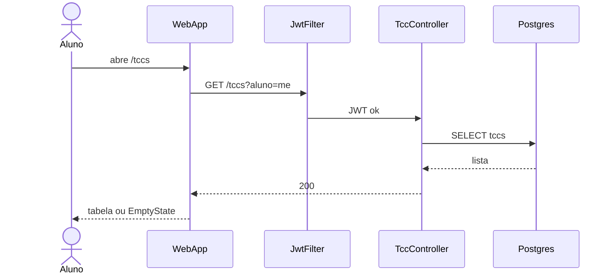

# F1.15-D01 — Listar TCCs do aluno

| Campo | Valor |
|---|---|
| HU | US-F1-008 |
| Escopo | happy path — TCCs registrados pela secretaria |
| Atores | Aluno, WebApp, JwtFilter, TccController, Postgres |
| Pré-condições | `tcc.view_own` |
| Origem | `docs/tcc-docs.md` §8.2 · CA-01 · RN-F1.15-01/02 |

## Passos

1. Aluno abre `/tccs`.
2. `GET /tccs?aluno=me`.
3. Sem `_links.novo` — abertura é da secretaria.

## Mermaid

## Export

[`F1.15-D01-listar-tccs.puml`](./F1.15-D01-listar-tccs.puml)
