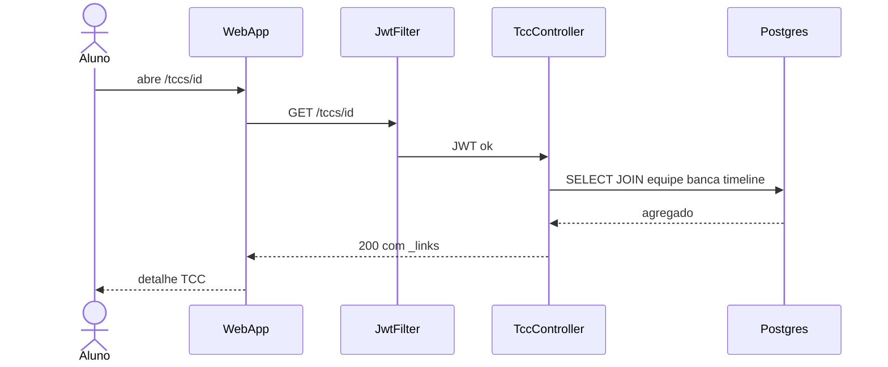

# F1.16-D02 — Detalhe do TCC

| Campo | Valor |
|---|---|
| HU | US-F1-008 |
| Escopo | equipe, banca, datas, timeline e `_links` numa resposta |
| Atores | Aluno, WebApp, JwtFilter, TccController, Postgres |
| Pré-condições | TCC pertence ao aluno |
| Origem | `docs/tcc-docs.md` §8.2 · CA-03 · RN-F1.16-01/02/04 |

## Passos

1. `GET /tccs/{id}` — JOIN único.
2. `_links.upload-final` só se o estado permitir submissão.
3. Timeline de avaliações da banca na mesma payload.

## Mermaid

## Export

[`F1.16-D02-detalhe-tcc.puml`](./F1.16-D02-detalhe-tcc.puml)
