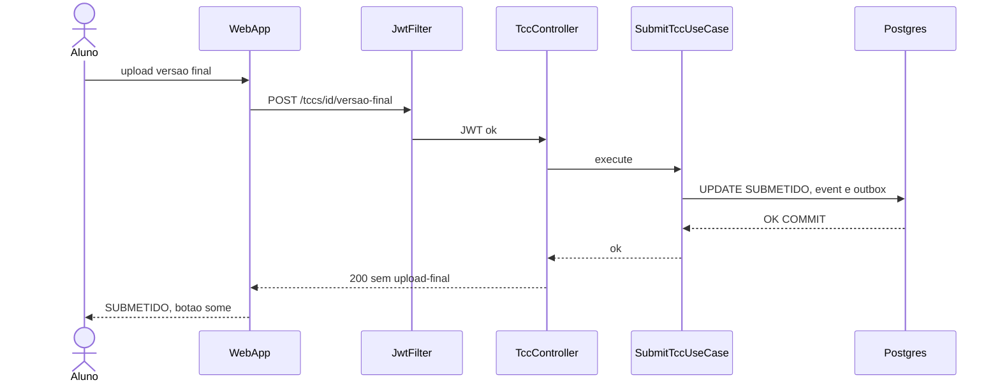

# F1.16-D03 — Enviar versão final do TCC

| Campo | Valor |
|---|---|
| HU | US-F1-008 |
| Escopo | `POST /tccs/{id}/versao-final` multipart + Outbox para banca |
| Atores | Aluno, WebApp, JwtFilter, TccController, SubmitTccUseCase, Postgres |
| Pré-condições | `_links.upload-final` presente |
| Origem | `docs/tcc-docs.md` §8.2 · CA-02 · RN-F1.16-03 |

## Passos

1. Aluno envia PDF final.
2. UseCase: guard de dono; estado → `SUBMETIDO`; `tcc_event` + `outbox_event` na mesma TX.
3. Resposta sem `_links.upload-final` — botão some via HATEOAS.

## Mermaid

## Export

[`F1.16-D03-enviar-versao-final.puml`](./F1.16-D03-enviar-versao-final.puml)
