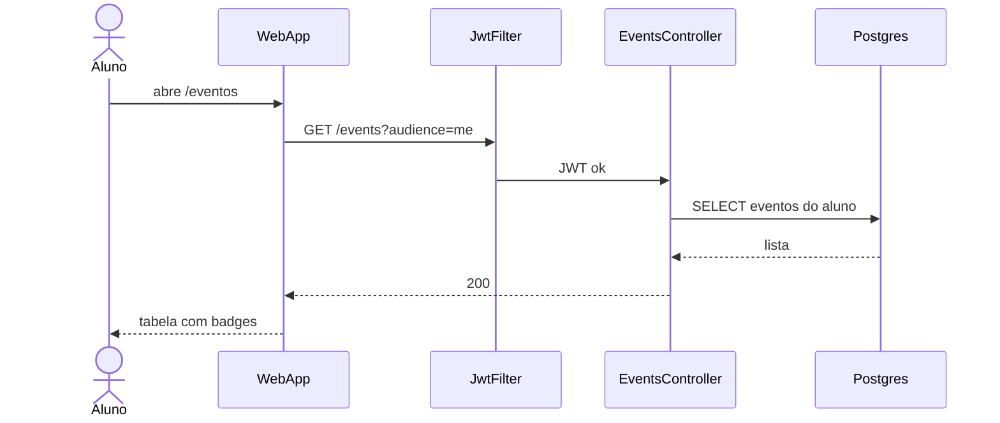

# F1.17-D01 — Listar eventos disponíveis

| Campo | Valor |
|---|---|
| HU | US-F1-009 |
| Escopo | happy path — tabela com estado e situação de presença |
| Atores | Aluno, WebApp, JwtFilter, EventsController, Postgres |
| Pré-condições | `attendance.view_open` |
| Origem | `docs/tcc-docs.md` §8.2 · CA-01 · RN-F1.17-01 |

## Passos

1. Aluno abre `/eventos`.
2. `GET /events?audience=me`.
3. Cada item traz `situacaoPresenca` (PENDENTE / PARCIAL / COMPLETA) e badge se `janelaAtiva`.

## Mermaid

## Export

[`F1.17-D01-listar-eventos.puml`](./F1.17-D01-listar-eventos.puml)
