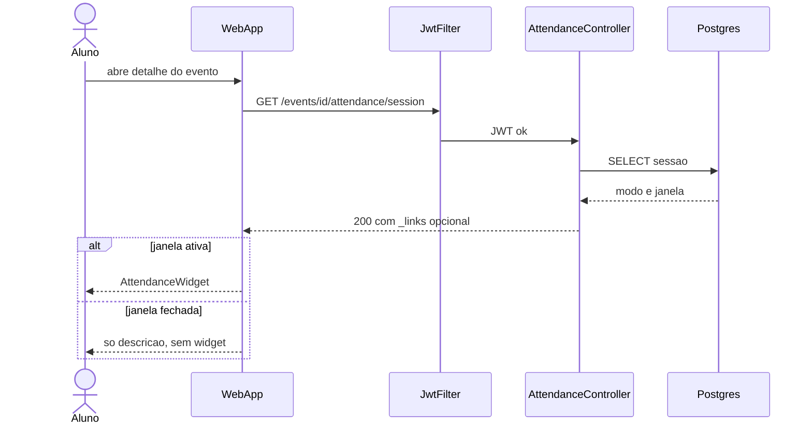

# F1.17-D02 — Modal de detalhe / sessão de presença

| Campo | Valor |
|---|---|
| HU | US-F1-009 |
| Escopo | detalhe + session; `_links.confirmar-presenca` só com janela ativa |
| Atores | Aluno, WebApp, JwtFilter, AttendanceController, Postgres |
| Pré-condições | `attendance.view_open` |
| Origem | `docs/tcc-docs.md` §8.2 · CA-02/03 · RN-F1.17-02/03 |

## Passos

1. Aluno abre detalhe do evento.
2. `GET /events/{id}/attendance/session`.
3. Se janela ativa → `_links.confirmar-presenca` + widget; senão, só dados (sem widget).

## Mermaid

## Export

[`F1.17-D02-sessao-presenca.puml`](./F1.17-D02-sessao-presenca.puml)
