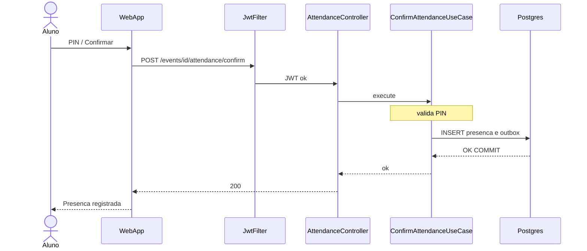

# F1.18-D03 — Confirmar presença SECRET_SINGLE

| Campo | Valor |
|---|---|
| HU | US-F1-009 |
| Escopo | happy path — PIN + deviceUuid; presença completa + Outbox |
| Atores | Aluno, WebApp, JwtFilter, AttendanceController, ConfirmAttendanceUseCase, Postgres |
| Pré-condições | `_links.confirmar-presenca`; modo SECRET_SINGLE; janela ativa |
| Origem | `docs/tcc-docs.md` §8.2 · CA-04 · RN-F1.18-01/06/08 |

## Passos

1. Aluno informa PIN e confirma (`deviceUuid` do cliente).
2. UseCase valida PIN em memória; TX registra presença (device binding) + outbox.
3. `200` → banner success; situação COMPLETA.

> QR_SINGLE usa o mesmo endpoint com `token` no lugar de `pin`.

## Mermaid

## Export

[`F1.18-D03-presenca-single.puml`](./F1.18-D03-presenca-single.puml)
