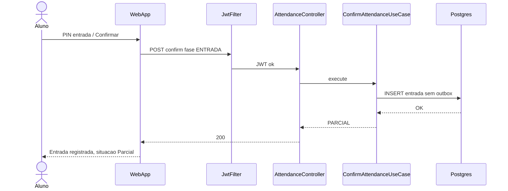

# F1.18-D04 — Confirmação DUAL fase ENTRADA

| Campo | Valor |
|---|---|
| HU | US-F1-009 |
| Escopo | ENTRADA → situação PARCIAL; Outbox só após SAÍDA |
| Atores | Aluno, WebApp, JwtFilter, AttendanceController, ConfirmAttendanceUseCase, Postgres |
| Pré-condições | janela de ENTRADA ativa; sem entrada prévia |
| Origem | `docs/tcc-docs.md` §8.2 · CA-05 · RN-F1.18-02 |

## Passos

1. Aluno confirma PIN/token de entrada.
2. Registra fase ENTRADA; **sem** `outbox_event` ainda.
3. Situação PARCIAL; `_links.confirmar-saida` quando a janela de saída abrir.

## Mermaid

## Export

[`F1.18-D04-presenca-dual-entrada.puml`](./F1.18-D04-presenca-dual-entrada.puml)
