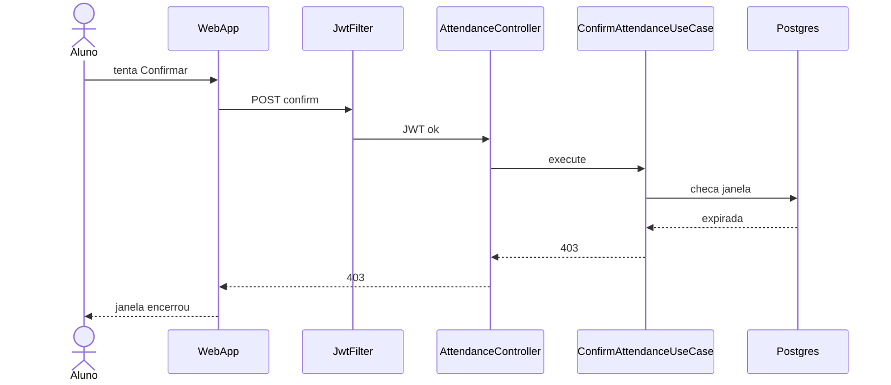

# F1.18-D05 — Confirmação fora da janela → 403

| Campo | Valor |
|---|---|
| HU | US-F1-009 |
| Escopo | janela expirada/inativa; backend rejeita sem detalhar política |
| Atores | Aluno, WebApp, JwtFilter, AttendanceController, ConfirmAttendanceUseCase, Postgres |
| Pré-condições | countdown zerou ou janela inativa |
| Origem | `docs/tcc-docs.md` §8.2 · CA-06 · RN-F1.18-05/07 |

## Passos

1. Aluno tenta confirmar (ou countdown local já bloqueou o widget).
2. UseCase verifica janela → `403` genérico.
3. UI: EmptyState “A janela de validação encerrou.”

## Mermaid

## Export

[`F1.18-D05-presenca-fora-janela.puml`](./F1.18-D05-presenca-fora-janela.puml)
