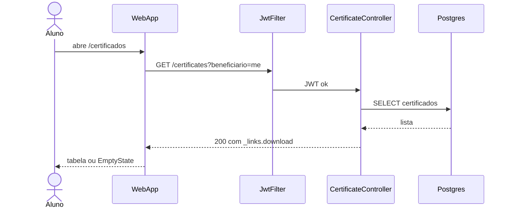

# F1.19-D01 — Listar certificados do aluno

| Campo | Valor |
|---|---|
| HU | US-F1-010 |
| Escopo | happy path — tabela filtrável; só leitura |
| Atores | Aluno, WebApp, JwtFilter, CertificateController, Postgres |
| Pré-condições | `certificate.view_own` |
| Origem | `docs/tcc-docs.md` §8.2 · CA-01 · RN-F1.19-02 |

## Passos

1. Aluno abre `/certificados`.
2. `GET /certificates?beneficiario=me` (+ tipo/ano).
3. Cada item com `_links.download` via `useActions`.

## Mermaid

## Export

[`F1.19-D01-listar-certificados.puml`](./F1.19-D01-listar-certificados.puml)
