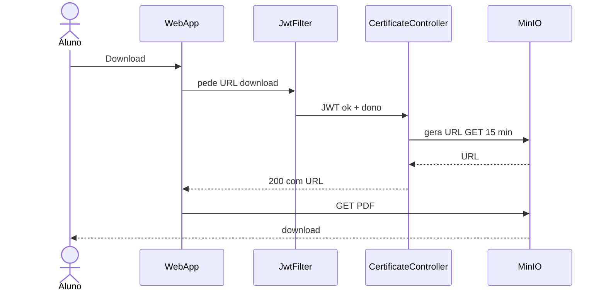

# F1.19-D02 — Download do PDF do certificado

| Campo | Valor |
|---|---|
| HU | US-F1-010 |
| Escopo | backend gera URL GET temporária no MinIO (15 min) |
| Atores | Aluno, WebApp, JwtFilter, CertificateController, MinIO |
| Pré-condições | `_links.download` presente |
| Origem | `docs/tcc-docs.md` §8.2 · CA-02 · RN-F1.19-03 |

## Passos

1. Aluno clica Download.
2. Controller checa dono e pede URL pré-assinada ao MinIO.
3. Browser baixa o PDF (com QR de verificação F0.7).

## Mermaid

## Export

[`F1.19-D02-download-certificado.puml`](./F1.19-D02-download-certificado.puml)
