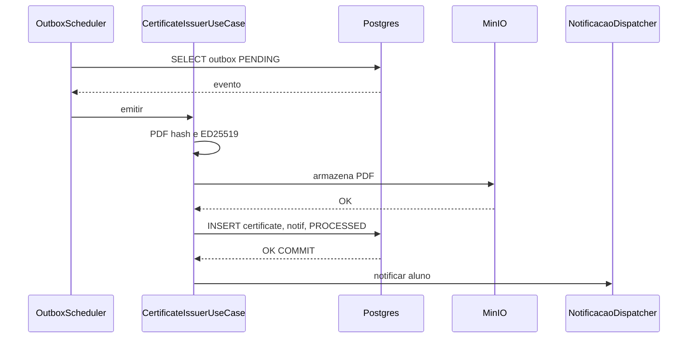

# F1.19-D03 — Emissão automática de certificado (background)

| Campo | Valor |
|---|---|
| HU | US-F1-010 |
| Escopo | Outbox processa `presenca.confirmed` / `formativa.approved` |
| Atores | OutboxScheduler, CertificateIssuerUseCase, Postgres, MinIO, NotificacaoDispatcher |
| Pré-condições | outbox PENDING com um desses tipos |
| Origem | `docs/tcc-docs.md` §8.2 · CA-03 · RN-F1.19-01 |

## Passos

1. Scheduler pega evento PENDING.
2. UseCase gera PDF + SHA-256 + assinatura ED25519; grava no MinIO.
3. TX: INSERT certificate + notificação + marca outbox PROCESSED.
4. Aluno recebe in-app/e-mail; KPI do dashboard sobe no próximo poll.

## Mermaid

## Export

[`F1.19-D03-emissao-automatica.puml`](./F1.19-D03-emissao-automatica.puml)
