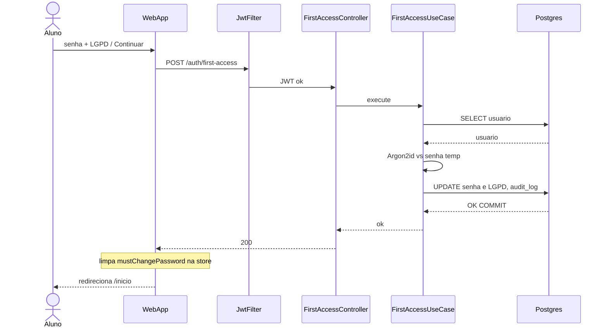

# F1.2-D01 — Conclusão bem-sucedida do primeiro acesso

| Campo | Valor |
|---|---|
| HU | US-F1-002 |
| Escopo | happy path — senha forte + LGPD → desbloqueia o sistema |
| Atores | Aluno, WebApp, JwtFilter, FirstAccessController, FirstAccessUseCase, Postgres |
| Pré-condições | `mustChangePassword = true`; senha forte não reutilizada; checkbox LGPD marcado |
| Origem | `docs/tcc-docs.md` §8.2 · CA-04 |

## Passos

1. Aluno em `/primeiro-acesso` envia senha + aceite LGPD.
2. `POST /auth/first-access` via JwtFilter.
3. UseCase carrega usuário; self-call Argon2id garante nova senha ≠ temporária.
4. TX: `UPDATE` senha (`senha_alterada=true`), `aceite_lgpd_em`, `audit_log` (`iam.first_access_completed`).
5. `200` → WebApp limpa `mustChangePassword` na store → redireciona `/inicio`.

> Nenhum JWT novo: o guard usa o flag da store, não claim do token.

## Mermaid

## Export

[`F1.2-D01-primeiro-acesso-ok.puml`](./F1.2-D01-primeiro-acesso-ok.puml)
