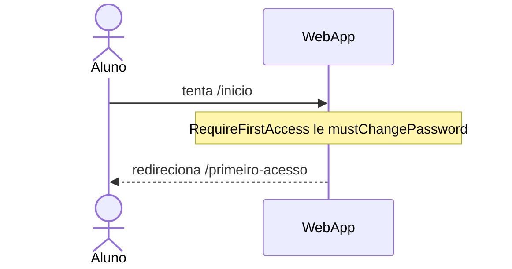

# F1.2-D02 — Bloqueio de navegação (`mustChangePassword` guard)

| Campo | Valor |
|---|---|
| HU | US-F1-002 |
| Escopo | tenta rota protegida com primeiro acesso pendente |
| Atores | Aluno, WebApp |
| Pré-condições | autenticado; `mustChangePassword = true` na store |
| Origem | `docs/tcc-docs.md` §8.2 · CA-05 · RN-F1.2-01/02 |

## Passos

1. Aluno tenta ir para `/inicio` (ou outra rota protegida).
2. Guard `<RequireFirstAccess>` lê o flag na store — **sem HTTP**.
3. Redireciona de volta para `/primeiro-acesso`; sidebar sem links.

## Mermaid

## Export

[`F1.2-D02-bloqueio-navegacao.puml`](./F1.2-D02-bloqueio-navegacao.puml)
