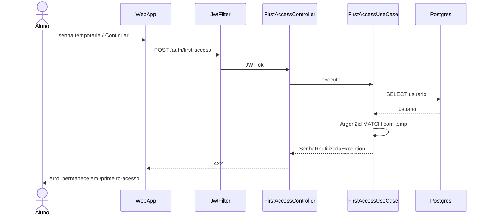

# F1.2-D03 — 422 senha igual à temporária

| Campo | Valor |
|---|---|
| HU | US-F1-002 |
| Escopo | nova senha idêntica à senha temporária do sistema |
| Atores | Aluno, WebApp, JwtFilter, FirstAccessController, FirstAccessUseCase, Postgres |
| Pré-condições | `mustChangePassword = true`; aluno reenvia a senha temporária |
| Origem | `docs/tcc-docs.md` §8.2 · RN-F1.2-05 |

## Passos

1. `POST /auth/first-access` com a senha temporária.
2. UseCase: Argon2id.verify = true (é a mesma) → `SenhaReutilizadaException` + ROLLBACK.
3. `422` Problem Details (mensagem genérica; sem revelar a senha).
4. WebApp exibe erro; aluno permanece em `/primeiro-acesso`.

## Mermaid

## Export

[`F1.2-D03-senha-temporaria.puml`](./F1.2-D03-senha-temporaria.puml)
