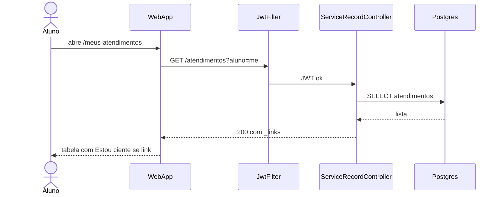

# F1.20-D01 — Listar atendimentos

| Campo | Valor |
|---|---|
| HU | US-F1-011 |
| Escopo | tabela com badge e filtro; botão só via `_links.acknowledge` |
| Atores | Aluno, WebApp, JwtFilter, ServiceRecordController, Postgres |
| Pré-condições | `service_record.view_own` |
| Origem | `docs/tcc-docs.md` §8.2 · CA-01/03 · RN-F1.20-01/02 |

## Passos

1. Aluno abre `/meus-atendimentos`.
2. `GET /atendimentos?aluno=me` (+ filtro pendente).
3. Itens `PENDENTE_CIENCIA` trazem `_links.acknowledge`.

## Mermaid

## Export

[`F1.20-D01-listar-atendimentos.puml`](./F1.20-D01-listar-atendimentos.puml)
