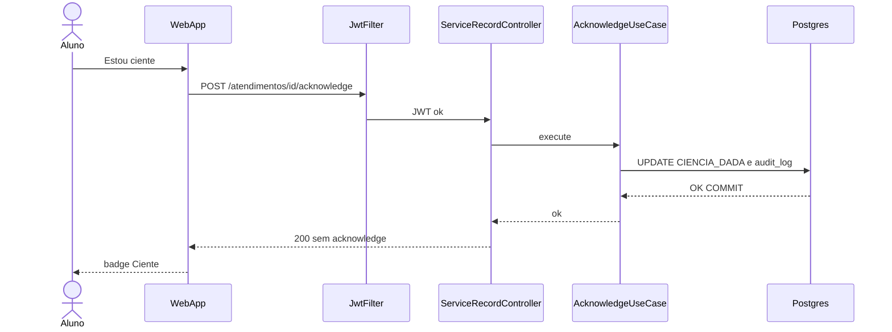

# F1.20-D02 — Dar ciência

| Campo | Valor |
|---|---|
| HU | US-F1-011 |
| Escopo | `POST .../acknowledge` → `CIENCIA_DADA` + audit_log |
| Atores | Aluno, WebApp, JwtFilter, ServiceRecordController, AcknowledgeUseCase, Postgres |
| Pré-condições | `_links.acknowledge`; status `PENDENTE_CIENCIA` |
| Origem | `docs/tcc-docs.md` §8.2 · CA-02 · RN-F1.20-03 |

## Passos

1. Aluno clica **Estou ciente**.
2. UseCase: UPDATE com guards (status + dono) + audit_log na mesma TX.
3. Resposta sem `_links.acknowledge` — botão some; pendência some do dashboard no próximo poll.

## Mermaid

## Export

[`F1.20-D02-dar-ciencia.puml`](./F1.20-D02-dar-ciencia.puml)
