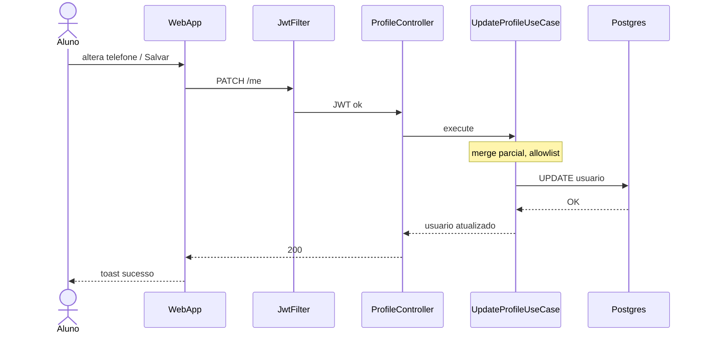

# F1.3-D01 — Editar dados pessoais (`PATCH /me`)

| Campo | Valor |
|---|---|
| HU | US-F1-003 (HU-A) |
| Escopo | happy path — atualiza dado pessoal (ex.: telefone) |
| Atores | Aluno, WebApp, JwtFilter, ProfileController, UpdateProfileUseCase, Postgres |
| Pré-condições | `/perfil` populado via `GET /me`; formulário dirty |
| Origem | `docs/tcc-docs.md` §8.2 · CA-01 · RN-F1.3 |

## Passos

1. Aluno altera campo e clica **Salvar**.
2. `PATCH /me` via JwtFilter → ProfileController → UpdateProfileUseCase.
3. Merge parcial (só campos enviados); GRR / e-mail institucional ignorados.
4. Postgres `UPDATE` → `200` com usuário completo.
5. WebApp toast success e sincroniza o formulário.

> **Cancelar** só descarta o estado local — sem diagrama dedicado.

## Mermaid

## Export

[`F1.3-D01-editar-perfil.puml`](./F1.3-D01-editar-perfil.puml)
