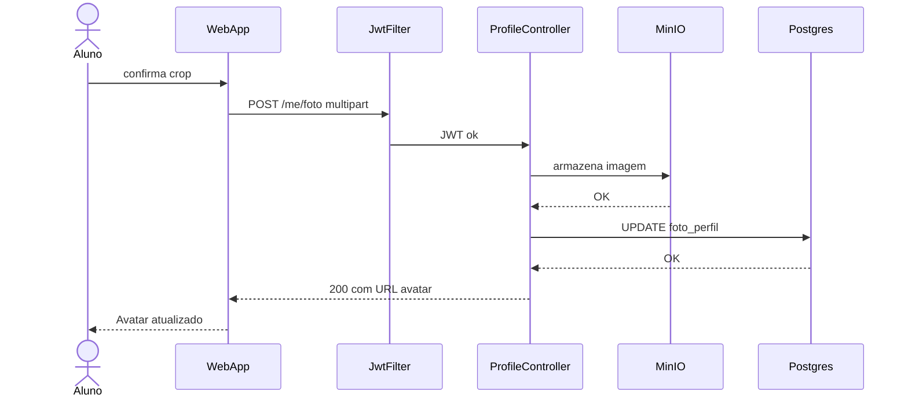

# F1.3-D02 — Upload de foto de perfil (`POST /me/foto`)

| Campo | Valor |
|---|---|
| HU | US-F1-003 (HU-A) |
| Escopo | happy path — multipart no servidor; browser **não** faz PUT no MinIO |
| Atores | Aluno, WebApp, JwtFilter, ProfileController, MinIO, Postgres |
| Pré-condições | imagem ≤ 2 MB; JPEG/PNG/WebP; crop circular confirmado |
| Origem | `docs/tcc-docs.md` §8.2 · CA-02 |

## Passos

1. Aluno confirma o crop no modal.
2. WebApp → `POST /me/foto` (multipart) via JwtFilter.
3. ProfileController grava no MinIO e atualiza referência no Postgres.
4. `200` com nova URL/avatar; WebApp atualiza o DS/Avatar.

> &gt; 2 MB: rejeição só no front (File API), sem HTTP.

## Mermaid

## Export

[`F1.3-D02-upload-foto.puml`](./F1.3-D02-upload-foto.puml)
